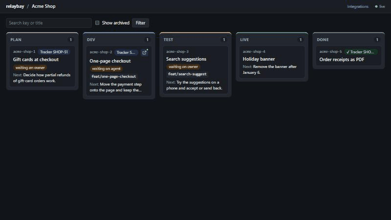

# relaybay

[](https://github.com/Codenator81/relaybay/actions/workflows/ci.yml)
[](https://pypi.org/project/relaybay/)
[](LICENSE)
[](https://codenator81.github.io/relaybay/)

A live board and MCP server for people who run many Claude Code sessions across many repositories.
Sessions report their work through MCP tools; you watch **projects → tasks → stages → reports** update
in the browser, on the desktop or on your phone.

> **Status: 0.6, early.** relaybay is built for my own workflow first and changes quickly; Windows is
> what it runs on every day, macOS and Linux are beta. Expect rough edges; issues and ideas are welcome.



## Why relaybay

- **One board for every session.** Ten repositories, ten Claude Code sessions: the board shows
  which one is working, which one waits for you and what it did, without opening each terminal.
- **Accept the work by eye.** Agents write a checklist of what to check and attach screenshots;
  you accept or reject step by step, and your comments reach the agent in its next turn.
- **Local and plain.** One process, SQLite, bound to `127.0.0.1`, token-protected, no telemetry;
  an installer for Windows, macOS and Linux, or `uvx relaybay` from the command line.

## Quick start

```bash
uv tool install relaybay      # or: pipx install relaybay  ·  or run it once: uvx relaybay
relaybay serve                # prints the board's login link and the MCP URL
relaybay setup                # shows how it connects Claude Code (then --apply --expect <hash>)
```

Just looking? `relaybay demo --home ./relaybay-demo` fills a folder with two made-up projects, then
`relaybay serve --home ./relaybay-demo --port 8766` shows them.

Open the login link once; the browser keeps a cookie. `relaybay token` prints the token again with
the `claude mcp add …` command for Claude Code. Docker, Windows/macOS/Linux details and a procedure
your coding agent can follow for you:
[Install](https://codenator81.github.io/relaybay/getting-started/install/) ·
[Install with your coding agent](https://codenator81.github.io/relaybay/getting-started/agent-install/).
Something off? `relaybay doctor`.

## Install

**The desktop program** (a tray icon, the board in a window, the server inside, start at login)
comes as an installer on each [release](https://github.com/Codenator81/relaybay/releases/latest).
The installers are not signed with a certificate, so the OS warns once:

- **Windows** (x64): run `relaybay-<version>-windows-x64-setup.exe`. It installs for your user only,
  without admin rights, into `%LOCALAPPDATA%\Programs\relaybay`. SmartScreen says "Windows protected
  your PC": click **More info**, then **Run anyway**.
- **macOS** (Apple silicon, beta): open `relaybay-<version>-macos-arm64.dmg` and drag relaybay to
  Applications. The first start is blocked: System Settings → Privacy & Security → **Open Anyway**
  (macOS 15 no longer offers right-click → Open), or run
  `xattr -dr com.apple.quarantine /Applications/relaybay.app`.
- **Linux** (amd64 `.deb`, beta): `sudo apt install ./relaybay_<version>_amd64.deb`. A tray icon and
  the board in your browser (no window); GNOME needs the AppIndicator extension for the tray.

Then connect Claude Code from the installed program: `relaybay setup`, then
`relaybay setup --apply --expect <hash>` (or Settings → Reconnect Claude Code in the program).
Check the files with `SHA256SUMS.txt` from the same release if you like.

**The command line** (any OS, Python 3.12+): `uv tool install relaybay`, `pipx install relaybay`,
`uvx relaybay`, or the Docker image `ghcr.io/codenator81/relaybay`. Details:
[Install](https://codenator81.github.io/relaybay/getting-started/install/); a server in Docker with the
program as its client:
[how-to](https://codenator81.github.io/relaybay/how-to/docker-server-with-desktop-client/).

**Documentation:** [codenator81.github.io/relaybay](https://codenator81.github.io/relaybay/) ·
[Specification](docs/SPEC.md) (how it behaves now) · [Roadmap](docs/ROADMAP.md) ·
[Architecture](docs/architecture.md)

## Features

- **Board** — projects with per-stage counts; per project, columns `plan → dev → review → test → live → done` on two pages
  with cards showing only the essentials: key, tracker badge, an "open in desktop" icon when a
  desktop session works on the task, title, waiting-on person, branch and the next step (a
  Compact toggle leaves key, tracker, title and who it waits on, with a chevron per card). Drag
  cards to set their order in a column or to move them to another stage (or use the card's ⋯ menu
  from the keyboard or a phone). Click a card to open the task in a dialog over the live board (its own URL,
  `/p/<project>?task=<key>`, full screen on a phone): description and progress in full, reports,
  session history, "Open in desktop", unbinding the session and editing the task. Each task also has
  a page of its own (`/t/<key>`). Live updates over Server-Sent Events, catch-up after sleep or a
  dropped connection, a stage tab bar on narrow screens; ← / → switch the two board pages.
- **Repositories and "Open in VS Code"** — a project lists its repositories (Stands & access, or
  `project_upsert(repos=…)`); each card shows the ones the task touches with its pull requests and
  an "Open in VS Code" link, linked by agents (`task_update(repos=…, prs=…)`) or by the hooks from
  the folder a bound session works in.
- **Quick switcher and saved filters** — Ctrl+K (Cmd+K on macOS) finds any task, project or
  session by a few letters; board filters by stage, waiting-on and session stay in the URL and can
  be saved as chips on the board and items in the sidebar.
- **Review** — agents write what you should check by eye as a checklist and attach screenshots
  (`review_steps_set`, `attach_file`); you accept or reject each step in the task's Review tab,
  look at screenshots full screen, draw on them and drop numbered pins for the agent, paste your
  own with Ctrl+V, and each decision reaches the
  agent as a comment. Tasks waiting for acceptance are in the Inbox's Review queue; an optional
  browser notification (Settings → Notifications) says when one arrives, and the desktop program's
  tray says it with no tab open. How agents make
  screenshot files: [Screenshots for review](https://codenator81.github.io/relaybay/how-to/screenshots-for-review/).
- **Next step that keeps up** — sessions pass the next step and who acts next together with a
  stage change or a report; a next step left over from before the last stage change shows muted
  and marked "stale".
- **Done column and archive** — the `done` column shows tasks closed in the last
  `done_window_days` (default 7); older ones are archived and come back with "Show archived" or a
  search by key or title (`/p/<project>?archived=1`, `?q=…`). Done cards hide "waiting on" and the
  next step.
- **External tracker mark** — a task can carry its issue in any tracker (tracker name, issue key,
  optional link) and a "work log entered" mark. The card shows the issue as a badge at the top (a
  link when a URL is set, ✓ once logged). With `require_tracker_log = true` a done task without
  the mark shows "not logged" and stays out of the archive until it is marked. Every issue key a
  task has had is kept in its tracker history (task dialog, `/t/<key>`, `task_get`), and new work
  on a logged task (a report, a progress change, a move back from `live` or `done`) clears the
  mark again, so it always means "the log covers everything done".
- **Comments to agents** — write a comment on a task (dialog or task page) and the agent of the
  bound session gets it through its hooks with its next prompt or tool call; the thread shows
  "sent / delivered / read" live, `Stop` reminds the agent (at most twice) until it acknowledges,
  and agents answer with `comment_add` (their replies land in your Inbox). An opt-in
  wake-up hook (`relaybay setup --apply --wake`, Claude Code 2.1.309+) wakes an idle session for a new
  comment or your acceptance of its plan.
- **Intake and backlog** — a watcher you run (Telegram and e-mail examples in `examples/intake/`)
  posts chat and mail messages; relaybay ties them to the waiting task and marks it "answer
  received", and only a trusted source on a task with autonomy on lets the agent go on by itself.
  Findings and ideas wait on the backlog until you plan them
  ([guide](https://codenator81.github.io/relaybay/how-to/intake/)).
- **Stands & access** — per project, the local, test and live environments with their base URL and
  how agents reach them (ssh alias, kube context, database host, GitOps repository, log links),
  stored as references only, never secrets; agents' permission level per environment (`none`,
  `read`, `ask`, `full`; live is `read` by default), changed only by you on the board (agents
  propose with `environment_propose`). The `PreToolUse` hook warns about or blocks a command aimed
  at an environment its level forbids — a safety net against mistakes, not a sandbox — and every
  agent tool call that touches live lands in a journal (the Audit page, with filters). A
  **No live now** switch on a session denies it any touch of live at its next tool call.
- **Policy as data** — the levels, the guard and the secret checks come from a policy, not from
  the code: a preset (`default`, `strict`, `trusted`), an optional `policy.json` in the data
  directory and project or environment layers, each value showing which layer set it (Settings →
  Policy, `policy_get`). A trusted machine can give agents full access with the guard only
  journaling and keep harmless test passwords on local and test stands (masked, not sent to agents
  unless you say so, never on live). Agents propose changes with `policy_propose`.
- **Docs & rules** — per project, versioned documents (spec, status, task notes, runbooks) with
  section anchors and diffs, edited on the board or by agents, linked from tasks down to a section,
  or pointing at the repository they live in; decisions that supersede each other instead of being deleted, memory notes
  and blocks agents keep for the next session, full-text search over all of it, and the rules.
- **Plan and checkpoints** — agents write the task's plan (`plan_set`) and mark each step done
  with one line, `as planned` or `deviation: why`; you accept the plan in the task's Plan tab,
  deviations stand out on the card, and the agent's own Claude Code todo shows under the current
  step. By default a move to `dev` needs an accepted plan unless the task is size `S`. The plan
  stays alive: work added after a report is a new step (`plan_step_add`, the acceptance kept) and
  takes the task back to `dev`.
- **Usage** — tokens by session and model, per day and week and per project, read locally from the
  Claude Code transcripts the hooks report: only `usage` numbers and the model name are kept, never
  prompt or output text, and no prices or quotas. Turn it off with `usage_enabled = false`.
- **MCP server** — Streamable HTTP at `/mcp` in the same process: create and update tasks, change
  stages, keep a task's description and progress summary current, add reports and decisions, bind
  and unbind sessions, get a markdown snapshot of a project. A plain session name never replaces a
  task's desktop session binding: it becomes that session's alias. `task_patch` takes any task
  fields as one JSON object, so clients with an older tool schema can still set new fields.
- **Working rules** — the server tells every connected session how to work with the board (MCP
  instructions: read the snapshot, pick a task, keep next step / waiting on / progress current,
  report as `state · size · gist`) and serves the rules as data: report format, what a stage move
  needs (by default an accepted plan before `dev` unless the task is size `S`, a report before
  `test`, `progress` before `done`), a description template and
  free-text guidance. Global rules come from `config.toml`, a project can override them; agents read
  them through `rules_get` or `relaybay://rules/<project>`, and `project_snapshot` starts with the
  rules version. Rules are versioned: agents change them with `rules_propose` and the owner accepts or
  rolls back in Settings → Rules. A stage move that misses a rule succeeds with a warning (or is refused with
  `rules_mode = "strict"`), in MCP responses and on the board.
- **Runs on a card** — relaybay can start your own unmodified `claude` on a card, on your
  machine only, under your own subscription sign-in; it never signs in for you or reads
  credentials, and refuses API-key sign-ins unless you allow them in Settings. The card's Agent
  block starts the first turn in the project folder or one of its repositories, each repository in
  a new git worktree (with its untracked `CLAUDE.md` and `.claude/` copied in, never added to git)
  or used in place, with a brief built from the card; then each Continue resumes the same Claude
  Code session (`--resume`); a text sent during a turn waits for it, Stop kills the turn's whole
  process tree, and the card shows the status, the Claude session id and each turn's tokens. The
  run's hooks report to its own session row on the card; when `relaybay setup` did not install
  them, the run passes them itself. Between turns you can open the session in the Claude desktop
  app (on Windows; elsewhere the card shows the `claude --resume` command) and hand it back, and
  change the permission mode, model and effort for the next turns. Coordinator sessions may start
  runs with `run_start` and lower a run's mode with `run_settings`; project
  defaults (model, effort, permission mode, allowed tools, project folder) are on Stands & access,
  the sign-in switch in Settings → Agents. relaybay runs `git worktree add`, never a commit or push.
- **Questions to you** — an agent asks with `question_ask`, always with a default; the question
  shows in your Inbox and on the card (a blocking one also in the tray), and only your answer on
  the board closes it. A run waits on a blocking question and your answer starts its next turn,
  verbatim; a desktop session gets it as an owner comment. A non-blocking question closes with its
  default at its deadline. "Look at this" questions carry the URL of a screen the agent brought up
  and the test account's name, never a password.
- **Desktop program** — an installer per OS puts relaybay in the tray with the board in its own
  window (on Linux in the browser) and the server inside: start at login, Restart server and Logs
  in the tray menu, a daily update check with **Update to X.Y.Z** that downloads and checks the
  release's installer, a backup of the data before a new version migrates it, and an external
  server mode that makes the program and the CLI clients of a relaybay running elsewhere (for
  example in Docker).
- **Local and private** — one process, SQLite, binds to `127.0.0.1`, token-protected, no telemetry,
  no CDN. The only outbound calls are a daily check of the latest GitHub release (a line in the
  Inbox, or a dot on the tray icon, when a newer one is out) and, when you click Update in the
  program, the download of that release's installer. `update_check = false` turns the check off:
  in `config.toml` for the server, in `desktop.toml` for the program.

## Bring your markdown

Briefs, a task registry, task notes and memory notes in markdown files come over with a dry run first,
and go back out for git history and backup: [import and export](https://codenator81.github.io/relaybay/how-to/markdown-import-export/).

```bash
relaybay import ./notes                               # the plan and its hash; writes nothing
relaybay import ./notes --apply --expect <hash>       # write exactly that plan
relaybay export ./notes --apply                       # the board back to the same layout
```

## Connect Claude Code

```bash
claude mcp add --transport http --scope user relaybay http://127.0.0.1:8765/mcp \
  --header "Authorization: Bearer <token>"
```

`user` scope adds relaybay once for all repositories. See
[docs/connect-claude-code.md](docs/connect-claude-code.md) for `.mcp.json` and a short instruction
snippet for your project's `CLAUDE.md` / `AGENTS.md` that tells the agent when to call the tools.

### Live session status (hooks)

```bash
relaybay setup                         # what it found, the exact diff and its hash
relaybay setup --apply --expect <hash> # adds relaybay's hooks to ~/.claude/settings.json
relaybay setup --check                 # end-to-end check, one ok/FAIL line per item
```

The hooks let the board show whether each session is working, waiting for you, idle or gone,
unbind a session from its task when it ends, and hand your comments to the agent of the task's
session. Setup adds only its own entries (other hooks stay as
they are), never writes the token into the file, and `--remove` takes them out again. The same plan
and buttons are on the board under **Settings → Integrations**. Hooks stay silent when relaybay is not
running. Details: [docs/connect-claude-code.md](docs/connect-claude-code.md#3-live-session-status-hooks).

### Schema changes and long-running sessions

A Claude Code session keeps the parameter schema of a tool it already loaded, even after relaybay
restarts and the client reconnects: new tools appear, but new parameters of an existing tool do
not. Use `task_patch(task, fields={...})` for fields your client does not know yet (the allowed
names are at the end of `task_get` and in `relaybay://schema/task`), or refresh the schemas by
reconnecting the server in the client (`/mcp` in the CLI) or starting a new session. See
[docs/mcp-tools.md](docs/mcp-tools.md#schema-changes-and-long-running-sessions). A release only adds
to the MCP tools; a removal is announced first by a `Deprecated: …` line
([contract](docs/mcp-tools.md#contract-and-deprecations)).
The tool reference is in [docs/mcp-tools.md](docs/mcp-tools.md).

## Configuration

Settings come from defaults, then `config.toml` in the data directory, then `RELAYBAY_*` environment
variables, then command-line flags.

| Setting | Default | Env | Flag |
|---|---|---|---|
| data directory | `data_dir` in the desktop program's `desktop.toml`, else the per-user data dir (`platformdirs`) | `RELAYBAY_HOME` | `--home` |
| bind address | `127.0.0.1` | `RELAYBAY_HOST` | `--host` |
| port | `8765` | `RELAYBAY_PORT` | `--port` |
| extra allowed Host names | none | `RELAYBAY_ALLOWED_HOSTS` (comma-separated) | — |
| desktop session link | `claude://claude.ai/epitaxy/{id}` | `RELAYBAY_DESKTOP_LINK_TEMPLATE` | — |
| days a done task stays in the done column | `7` | `RELAYBAY_DONE_WINDOW_DAYS` | — |
| keep done tasks without the tracker work log on the board | `false` | `RELAYBAY_REQUIRE_TRACKER_LOG` | — |
| what a stage move that misses a rule does: `warn` or `strict` | `warn` | `RELAYBAY_RULES_MODE` | — |
| `waiting_on` names that mean you (listed in the Inbox) | `owner`, `me`, `you` | `RELAYBAY_OWNER_NAMES` (comma-separated) | — |
| the global policy file ([policy reference](https://codenator81.github.io/relaybay/reference/policy/)) | `policy.json` in the data directory | `RELAYBAY_POLICY_FILE` | — |
| legacy: the guard mode (`off`, `log`, `warn`, `block`), a layer under the policy file | from the policy (`warn`) | `RELAYBAY_GUARD_MODE` | — |
| legacy: agents' level per environment kind (`[permission_defaults]`), a layer under the policy file | from the policy (local `full`, test `full`, live `read`) | — | — |
| folder with Claude Code's `.claude/` and `.claude.json` (setup, Integrations) | your home directory | `RELAYBAY_CLAUDE_HOME` | `--claude-home` |
| the `claude` a run on a card starts (`claude_path`) | `claude` on PATH, then the usual install folders | `RELAYBAY_CLAUDE_PATH` | — |
| extra folders `attach_file` may read screenshots from (besides the project repository and the temp folder) | none | `RELAYBAY_ATTACHMENT_ROOTS` (comma-separated) | — |
| largest screenshot / screenshots per task, MB | `10` / `200` | `RELAYBAY_ATTACHMENTS_MAX_MB` / `RELAYBAY_ATTACHMENTS_TASK_MAX_MB` | — |
| the server's update check of the latest GitHub release (`update_check`) | `true` | `RELAYBAY_UPDATE_CHECK` | — |
| hours between update checks (`update_check_hours`) | `24` | `RELAYBAY_UPDATE_CHECK_HOURS` | — |
| backups kept in `backups/`, one taken when a new version starts (`backup_keep`; `0` takes none) | `5` | `RELAYBAY_BACKUP_KEEP` | — |

The data directory holds `relaybay.sqlite`, the `token` file, `attachments/` (screenshots),
`backups/` (taken when a new version starts), `last_version` (the version that last started it),
`logs/` (the desktop program's log), the optional `config.toml` and the optional
`policy.json` (what agents may do; see
[Full access on a trusted local machine](https://codenator81.github.io/relaybay/how-to/trusted-machine/)
for an example):

```toml
port = 8765
allowed_hosts = ["my-laptop.lan"]   # needed only when you bind to a LAN address
desktop_link_template = "claude://claude.ai/epitaxy/{id}"  # {id} = desktop session id (local_…)
done_window_days = 7                # older done tasks are archived
require_tracker_log = false         # true: done tasks without the tracker work log stay and show "not logged"
owner_names = ["owner", "me"]       # waiting_on values listed in the Inbox
rules_mode = "warn"                 # "strict": a stage move or report that misses a rule is refused
coordinators = []                   # sessions that may use rules_update: a guard against mistakes, not access control

[stages.labels]                     # display names; the stage keys stay plan/dev/review/test/live/done
dev = "in progress"
done = "shipped"

[reports.labels]                    # report badges: inspected/changed/verified/committed/pushed/blocked, S/M/L
verified = "checked"

[reports.hints]                     # badge tooltips
M = "medium change"

[rules]                             # global working rules, merged over the built-in defaults; a change makes a new version
guidance = "Ask the owner before anything goes live."
description_template = "Goal:\nWhy:\nDone when:"

[rules.report_format]               # states/sizes: a subset of the built-in ones
sizes = ["S", "M", "L"]

[rules.stage_requirements]          # per target stage; a list replaces the default, [] drops it
test = [{ kind = "report_since_stage_change" }]
done = [{ kind = "field_present", field = "progress" }]
```

A rules error in `config.toml` (unknown key, stage, rule kind or field) stops `relaybay serve`
with a message that names the key. A broken project override never stops the server: it is
logged, the project falls back to the global rules, and `rules_get` and `project_snapshot` say
"project override ignored: <error>". Project overrides and the merge rules are described in
[docs/mcp-tools.md](docs/mcp-tools.md#working-rules).

`relaybay token --rotate` creates a new token; restart the server and update the Claude Code entry.

### Troubleshooting: "token not valid"

Each data folder has its own token. `relaybay serve` prints the folder it uses (`Data folder: …`);
run `relaybay token` with the same `--home` (or `RELAYBAY_HOME`). `relaybay token` prints its folder
and warns when the server on the port uses a different token (another folder, or a rotation without
a restart). After `relaybay token --rotate`, restart the server. `relaybay doctor` checks this and
everything else in one command ([troubleshooting](https://codenator81.github.io/relaybay/how-to/troubleshooting/)).

## Roadmap

- **0.1.0** — board, MCP tools, working rules, hooks and `relaybay setup`, packaging
  (`uv tool install`, `uvx`, `pipx`, Docker), `relaybay doctor`, docs site, demo workspace.
- **0.2.0** — sidebar navigation and Inbox, comments to agents, project environments and access,
  policy as data.
- **0.3.0** — review checklist with screenshots, memory and documents.
- **0.4.0** — map and usage, rules versioning, screenshot annotations, documents on the board.
- **0.5.0** — intake from chats and e-mail with an autonomy switch, the backlog.
- **0.6.0** — the desktop program: installers, tray, window, autostart, updates.
- **0.6.1** — desktop fixes: the program follows the machine's theme, the window keeps its state.
- **0.9, agents inside** — runs on a card with your own `claude` (the first part is in), then
  questions and approvals on the board, slots and memory limits; the embedded terminal in 0.10,
  the coordinator and schedules in 0.11.
- **0.7+, workers** — scheduled workers per project.
- **1.0** — a stable MCP contract, complete documentation, a migration path, tested on three
  operating systems.

Details and status: [docs/ROADMAP.md](docs/ROADMAP.md). Designs of upcoming steps are in
[docs/design/](docs/design/index.md), decisions in [docs/adr/](docs/adr/). relaybay sends no
telemetry.

## Contributing and feedback

- Questions, ideas, show and tell: [Discussions](https://github.com/Codenator81/relaybay/discussions).
- Bugs and feature requests: [issues](https://github.com/Codenator81/relaybay/issues/new/choose)
  (include `relaybay doctor` output for bugs).
- Security problems: report privately, see [SECURITY.md](SECURITY.md).
- Code: [CONTRIBUTING.md](CONTRIBUTING.md); AI coding tools: [AGENTS.md](AGENTS.md). Everyone
  follows the [Code of Conduct](CODE_OF_CONDUCT.md); how decisions are made:
  [GOVERNANCE.md](GOVERNANCE.md).

## License

[MIT](LICENSE)
